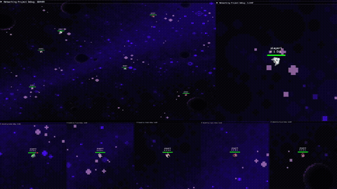

# Networking Project
A client-server multiplayer real-time 2D space shooter written in SFML as part
of a research project for networked games. Investigates if it's possible to
use TCP only for real-time shooter games.



# Compiling
## Prerequisites
- Windows (tested on Windows 10)
- [CMake](https://cmake.org/download/)
- [Ninja](https://ninja-build.org/)

## Build and Compile
In the root directory:
```bash
cmake -G Ninja -B build
ninja -C build
```

## Run
server.exe and client.exe will now be available in `build/bin`.

To run the server on localhost, make sure port 6429 is open and run:

```bash
.\build\bin\server.exe
```

The client runs on any available port on localhost and requires a handle
and skin index between 0-4 to run:

```bash
.\build\bin\client.exe player1 2
```

Port and IP settings can be edited in `modules/app/src/shared/config/settings.h`.

# Author
[Alastair Hamilton](alastair-hamilton.dev), alastair.amhamilton@icloud.com


